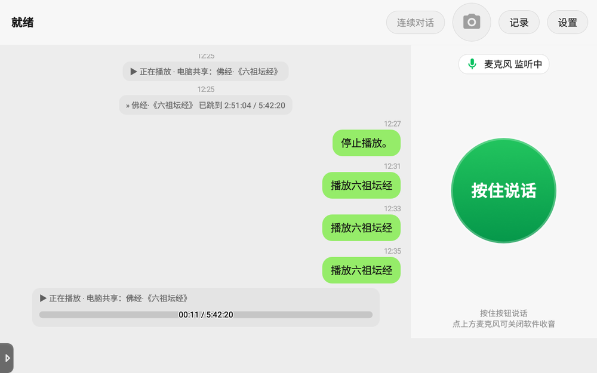
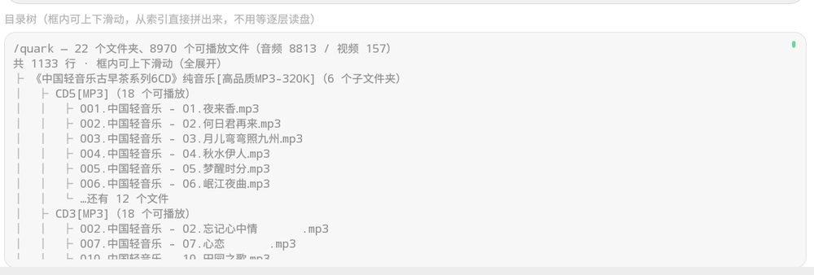

# 小智语音音箱 V1.0

> **当前发布版本：V1.0.1**（2026-10-31）。修了「自动换歌后停止/暂停失灵」「继续播放被当成歌名」「网络盘点播误命中共享盘同名歌」等 7 个问题，功能范围不变。
> 安装包见 [Releases](https://github.com/Outofearth/DingdangXiaozhi/releases)，`adb install -r` 覆盖安装即可，无需卸载。

给**腾讯叮当智能屏**（MT8167 / Android 8.1）写的原生语音客户端。把一台原本只能听厂商技能的智能屏，变成能语音点播自己整台电脑与网盘音乐库的播放器。

> 非官方项目。只在自己拥有的设备上使用，详见文末[免责声明](#免责声明)。


---

## 它解决什么问题

原厂固件把设备锁死在厂商技能生态里：能聊天，但放不了自己电脑里的歌，看不到局域网共享，更碰不到网盘。
官方小智客户端是 Flutter 写的，在这块板子的 Android 8.1 上录音插件不消费读取缓冲（`AudioRecord` 开了但 `Server=0`），上行永远是静音，说话等于没说。

这个客户端用原生 `AudioRecord` + 自编译 Opus JNI 重写了整条音频链路，在此之上把「说话 → 点歌 → 出声」接成了闭环。

## 功能

**语音对话**
- WebSocket 长连接，裸 Opus 帧（上行 16 kHz / 下行 24 kHz，60 ms 帧），和官方 xiaozhi-esp32 协议对齐
- 连续对话：本地 VAD 判停顿自动提交，不用反复按键
- 打断：说话即打断正在播的 TTS / 音乐，答完自动接回
- 设备绑定走 OTA 验证码流程，绑一次即可，无需固件级序列号

**四个播放源，一份清单**
| 来源 | 说明 |
|---|---|
| 本机 | `/sdcard/Music/xiaozhi` 等目录，直接扫盘 |
| 共享文件夹 | 局域网 SMB（Windows 共享），**边下边播**，不等整首下完 |
| 网络盘 | 经 [OpenList](https://github.com/OpenListTeam/OpenList) 网关访问夸克/阿里等网盘，HTTP Range 边下边播 |
| 云端缓存 | 云端唱过的歌整首落盘，二次点播免缓冲 |

四种来源统一成一份清单：一行一条、序号全局连续、按来源分组。听完说「播放第 3 个」就行——序号对得上，不用重复歌名。

**播放**
- 音视频自动判定，视频全屏出画面（进度条、字幕层、语音「快进到十分钟」）
- 播完行为可配：续播下一个 / 重播当前 / 放完就停
- 音量走设备真实档位（0–15），相对调节一次一档，绝对调节写完回读实际值
- 「正在播放」常驻聊天流最下方，长按可拖进度

**其他**
- 拍照问答：调用摄像头，图片上传后交给云端识图
- 聊天记录：本地留存 500 条，管理页可按今天/7 天/30 天筛选、批量删除、导出 TXT
- 局域网多设备同步：同账号设备之间 P2P 互推聊天记录，不经过服务端
- 待机悬浮入口、开机自启
- 缓存三处独立管理：整包缓存（600 MB LRU，共享盘与网盘合算）、下载残片、云端曲库

## 界面

| 正在播放 | 视频 | 存储与缓存 |
|---|---|---|
|  |  |  |

网络盘的目录树直接从本地索引拼出来，不逐层请求网关：



## 快速开始

**设备要求**：Android 7.0+（`minSdk 23`），ARM 架构；实测目标机为 Android 8.1 / armeabi-v7a / 1280×800 横屏。

1. 下载 `xiaozhi-speaker.apk`（见 Releases），安装：
   ```bash
   adb install -r xiaozhi-speaker.apk
   ```
2. 首次启动授予「麦克风 / 存储 / 相机」权限。
3. 打开 App，屏幕会显示一个 6 位验证码；到 [xiaozhi.me](https://xiaozhi.me) 登录后输入该码完成绑定。绑定成功后自动连接。
4. 按住绿色圆钮说话，松开即发送。

**接自己的音乐库**（可跳过，只聊天也能用）

- 共享文件夹：在设置页填电脑的局域网地址、共享名、账号（Windows 匿名共享可留空），点「测试连接」。
- 网络盘：先在电脑上跑一个 OpenList 网关，再在设置页填网关地址与账号。网关部署见 [docs/使用说明.md](docs/使用说明.md#网络盘网关)。

## 常用指令

| 说什么 | 会发生什么 |
|---|---|
| 「有哪些歌」/「网盘里有什么」 | 列出当前层的文件夹与文件（一行一条，屏幕全列、语音只念前 10 条） |
| 「查邓紫棋」/「打开第 3 个」 | 进入该文件夹，回报里面有什么 |
| 「下一批」/「返回上一层」/「回到根目录」 | 翻页与目录导航 |
| 「播放第 5 个」 | 按序号点播，序号与屏幕一致 |
| 「播放六祖坛经」 | 按名字直达（同名优先当前目录） |
| 「快进到十分钟」/「暂停」/「继续」/「退出」 | 视频页语音控制 |
| 「音量调到 50%」/「大声点」 | 调系统音量 |
| 「删除这条」/「导出记录」 | 聊天记录管理 |

## 构建

刻意**不用 Gradle**：目标设备是 API 27，依赖只有 5 个 jar，全部离线可复现。

```bash
cd xiaozhi-client
# 1) 准备工具链（platform-27、build-tools、okhttp/okio/jcifs/slf4j/bcprov）
export ANDROID_SDK=/path/to/android-sdk
# 2) 打包 + 对齐 + 签名（首次会自动生成 debug.keystore）
bash build.sh speaker      # speaker = 横屏音箱版；mobile = 自适应手机版
```

产出 `xiaozhi-client/xiaozhi-speaker.apk`。原生库 `prebuilt/*/libopusjni.so` 已随仓库提供；
确需重编 `libopus` 时见 [docs/构建与适配.md](docs/构建与适配.md)。

## 目录结构

```
xiaozhi-client/
  src/java/com/altc/xiaozhi/   # 45 个源文件，约 1.7 万行
    MainActivity               # 连接 / 语音意图分发 / 清单
    VideoActivity              # 视频页
    MediaSurvey                # 四源清单与版式
    LocalFiles / RemoteLibrary / NetDiskLibrary   # 本机 / SMB / 网盘
    SmbStreamSource / OlStreamSource              # 两条边下边播链路
    FileMusicPlayer / NowPlayingBar / VolumeCtl
    McpHandler / SyncManager / ChatStore …
  src/res/                     # 9 个布局、32 个 drawable
  src/jni/opus_jni.c           # Opus JNI 封装
  prebuilt/                    # 预编译 libopusjni.so（v7a + arm64）
  build.sh / compile_native.sh
tools/                         # 运行期辅助脚本（音量、缓存、推送音乐、SMB 共享）
docs/                          # 使用说明 / 技术架构 / 构建与适配
```

## 已知限制

- 只在**一台**叮当智能屏（Android 8.1、armeabi-v7a、1280×800）上实测过；其他机型需要自行适配分辨率与音频参数。
- 语音识别与对话能力依赖官方云端，断网只能做本地媒体播放。
- 网络盘必须经由 PC 上的 OpenList 网关，App 本身不直接对接各家网盘 SDK。
- 聊天记录上限 500 条，超出丢最旧的；媒体索引上限 12000 条。
- 视频播放用 `MediaPlayer`，个别编码（如非标准封装的 HEVC）可能不出画面。

## 免责声明

- 本项目**不是**腾讯或小米的官方产品，与设备厂商、小智官方均无关。
- 仅用于**自己拥有**的设备。刷机、改固件有变砖风险，请先完整备份；本项目不包含任何固件镜像、厂商密钥或设备身份信息。
- 请遵守你所在地区法律与各网盘服务的使用条款。仓库内不含任何破解、绕过付费墙或规避版权保护的代码。
- 仅供学习交流，按「现状」提供，不提供任何担保。

## 参考

- 协议对齐：[xiaozhi-esp32](https://github.com/78/xiaozhi-esp32)（OTA / WebSocket / 裸 Opus 帧）
- 网盘网关：[OpenList](https://github.com/OpenListTeam/OpenList)
- Opus 编解码：[libopus 1.3.1](https://opus-codec.org/)（BSD）
- SMB 客户端：[jcifs-ng](https://github.com/AgNO3/jcifs-ng)
